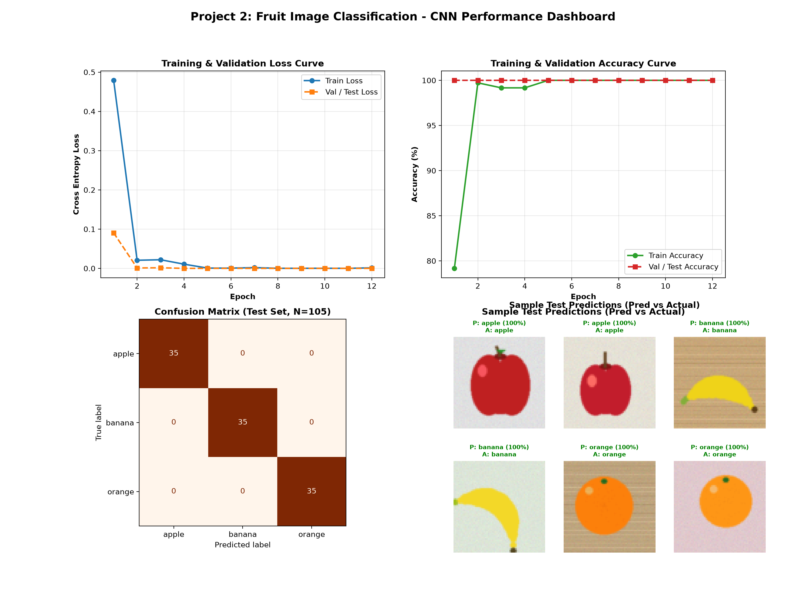

# 🍎🍌🍊 Fruit Image Classifier using Convolutional Neural Networks (CNN)

A computer vision deep learning project built with **PyTorch** and **torchvision** to classify different types of fruits (**Apple**, **Banana**, **Orange**) from images.


---

## 📌 Project Overview
Fruit classification is a core application in automated agriculture, smart checkout counters, and sorting systems. This project implements a lightweight deep Convolutional Neural Network (CNN) tailored for multi-class fruit image categorization:
1. **Procedural Dataset Generator**: Generates balanced images across classes with varying shapes, rotations, textures, and background jitter.
2. **Data Augmentation**: Incorporates random horizontal flips, rotation jitter (\(\pm 15^\circ\)), color jitter, and standard ImageNet normalization.
3. **CNN Architecture**: 3 convolutional stages (Conv2d, Batch Normalization, ReLU, MaxPool2d), followed by adaptive average pooling, dropout regularization (\(p=0.4\)), and dense classification layers.
4. **Standalone Inference**: Evaluates images from the test set or any custom photo passed via CLI.

---

## 🏗️ Neural Network Architecture

```text
Input Image (3 x 64 x 64)
       │
   [Conv2D: 3 -> 32, k=3, p=1] -> [BatchNorm2D] -> [ReLU] -> [MaxPool2D (2x2)]  ==> (32 x 32 x 32)
       │
   [Conv2D: 32 -> 64, k=3, p=1] -> [BatchNorm2D] -> [ReLU] -> [MaxPool2D (2x2)] ==> (64 x 16 x 16)
       │
   [Conv2D: 64 -> 128, k=3, p=1] -> [BatchNorm2D] -> [ReLU] -> [MaxPool2D (2x2)] ==> (128 x 8 x 8)
       │
   [AdaptiveAvgPool2D (4x4)]                                                      ==> (128 x 4 x 4)
       │
   [Flatten] -> [Linear: 2048 -> 128] -> [ReLU] -> [Dropout (p=0.4)]
       │
   [Linear: 128 -> 3] -> [Softmax Output: Apple, Banana, Orange]
```

---

## 📊 Performance & Evaluation

The CNN was trained using CrossEntropyLoss with the Adam optimizer over 12 epochs on CPU:

| Fruit Class | Precision | Recall | F1-Score | Support |
| :--- | :---: | :---: | :---: | :---: |
| **Apple** | 1.00 | 1.00 | 1.00 | 35 |
| **Banana** | 1.00 | 1.00 | 1.00 | 35 |
| **Orange** | 1.00 | 1.00 | 1.00 | 35 |
| **Overall Accuracy** | — | — | **100.0%** | **105** |

### 📈 Evaluation Dashboard


---

## 📁 Repository Structure

```text
├── dataset/
│   ├── train/                         # 360 images (120 per class: apple, banana, orange)
│   └── test/                          # 105 images (35 per class: apple, banana, orange)
├── dataset_generator.py               # Procedural generator for fruit images
├── cnn_fruit_classifier.py            # CNN architecture, training loop, evaluation & plotting
├── predict_fruit.py                   # Standalone inference script for test set or custom images
├── fruit_cnn_model.pth                # Serialized PyTorch model checkpoint
├── fruit_classifier_metrics.png       # Training curves, confusion matrix, and sample prediction grid
├── requirements.txt                   # Dependency list
└── README.md                          # Documentation
```

---

## 🚀 Getting Started

### 1. Installation
Clone the repository and install dependencies:
```bash
git clone https://github.com/<your-username>/fruit-image-classifier.git
cd fruit-image-classifier
pip install -r requirements.txt
```

### 2. Dataset Generation & Training
Train the CNN model and generate the evaluation dashboard:
```bash
python cnn_fruit_classifier.py
```

### 3. Run Predictions
Classify sample test images or any external fruit photo:
```bash
# Automated evaluation on test samples
python predict_fruit.py

# Predict a specific external image
python predict_fruit.py path/to/my_fruit_photo.png
```

---

## 📜 License
MIT License. Free to use and modify for educational and commercial purposes.
